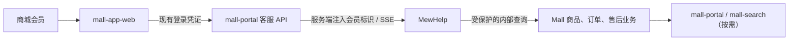

# 普通 Mall 接入 MewHelp 智能客服改造方案

- 状态：方案稿，待按本机源码版本核对接口
- 后端：[macrozheng/mall](https://github.com/macrozheng/mall)
- 用户端：[macrozheng/mall-app-web](https://github.com/macrozheng/mall-app-web)
- 客服：MewHelp（FastAPI，SSE 对话接口）
- 目标为普通 Mall，不是 mall-swarm；后台前端 mall-admin-web 暂不纳入

## 1. 仓库与架构边界

`macrozheng/mall` 是后端仓库；配套商城用户端是独立的 `macrozheng/mall-app-web`，采用 uni-app、Vue 3 和 TypeScript。后台管理前端另有 `mall-admin-web`。落地时需要分别准备 Mall 后端、用户端和 MewHelp 源码。

微服务技术上可以直接向前端开放，没有必须经过网关的限制。直接暴露时，每个服务需处理公网访问、HTTPS、跨域、认证、限流和服务地址管理；已有网关或 BFF 时，前端通常访问统一入口，再由它路由或聚合服务请求。本方案针对普通 Mall：前端访问 Mall 后端客服 API，由 Mall 服务端代理 MewHelp。MewHelp 和内部业务查询 API 不直接暴露给浏览器，服务凭据不进入前端。身份认证沿用普通 Mall 现有登录态和 `mall-security`，不套用 mall-swarm 的 Sa-Token/Gateway 方案。

## 2. 改造目标

商城用户从 mall-app-web 打开客服并收到流式答复；客服按当前登录会员身份查询 Mall 中的商品、订单、物流和售后信息。会话和历史消息绑定会员，客户端不能通过提交其他 `user_id` 更改身份。

一期先实现只读能力：商品搜索/详情、当前会员订单列表/详情、Mall 已记录的发货状态/运单号、售后申请状态。没有承运商轨迹接口时只报告 Mall 已记录的信息，不伪称实时物流。售后申请创建等写操作放入后续阶段，必须先展示操作内容并取得会员确认，再调用 Mall 现有流程。

## 3. 调用链和信任边界



1. 浏览器只调用 Mall 对外 API，不直连 MewHelp，也不持有 MewHelp 服务凭据。
2. mall-portal 从现有认证上下文取得会员 ID；忽略客户端提交的同名身份字段。
3. Mall 代理把服务端会员 ID 映射为 MewHelp 用户标识，并用于新建、续聊、会话列表及历史读取。
4. MewHelp 工具通过受认证的 Mall 内部 API 查询业务，不直接连接商城数据库。
5. Mall 每次校验订单/售后归属；会话 ID 也要校验所有者，不能把 ID 当作授权凭据。
6. 服务间接口需要专用凭据、网络限制、最小权限和审计；密钥通过环境变量或 Secret 注入。

## 4. 用户端改造（mall-app-web）

用户端已有按业务划分的 `src/apis`、`src/components`、`src/composables`、`src/pages`。建议按项目命名规范添加：

| 位置 | 职责 |
|---|---|
| `src/apis/customerService.ts` | 聊天、会话列表、历史消息 API，复用现有请求与认证 |
| `src/composables/useCustomerService.ts` | 会话/消息状态、流式解析、错误状态 |
| `src/components/customer-service/` | 客服入口、聊天面板、消息气泡、商品/订单卡片 |
| `src/pages/customer-service/` | 独立客服页；若采用浮窗可省略 |
| 页面路由/配置 | 注册页面，从首页、商品页或会员中心接入入口 |

交互支持新会话、历史切换、逐段显示、引用、卡片、连接中断、错误及登录过期提示。聊天是带请求体的 POST+SSE：H5 使用 `fetch` 读取响应流，不能用只支持 GET 的 `EventSource`。uni-app 各运行端能力不同，流式传输应做平台适配；先核实 H5，再决定小程序实现。具体文件名和路由以本机前端版本为准。

## 5. Mall 后端改造（mall）

### 5.1 对外客服 API

在 `mall-portal` 增加客服 API，路径服从现有 API 前缀和响应约定：

| 方法 | 建议路径 | 用途 |
|---|---|---|
| POST | `/api/customer-service/chat` | 发送消息并透传 MewHelp SSE |
| GET | `/api/customer-service/conversations` | 查询当前会员会话列表 |
| GET | `/api/customer-service/conversations/{id}/messages` | 查询当前会员历史消息 |

请求示例：

```json
{ "message": "我的订单到哪里了？", "conversationId": null }
```

请求只含消息和可选会话 ID。mall-portal 从现有认证上下文取得会员 ID，再构造发给 MewHelp 的请求；不使用客户端身份字段。MewHelp 的 `conversation_id` 与前端 `conversationId` 按实际协议映射。

代理通过支持流式响应的 HTTP 客户端按 SSE 事件转发并及时 flush；设置连接/读取超时；前端断开时关闭上游请求和响应。核实 Servlet 容器与反向代理的缓冲、空闲超时，避免 SSE 被缓存或过早断开。MewHelp 不可用时返回明确错误。

### 5.2 Mall 业务数据

优先复用 Mall 已有 Service、查询规则和归属校验。MewHelp 需要查询时由 Mall 提供受保护的内部接口；实际路由、DTO、Service 方法以本机源码为准。

| 能力 | 数据源 | 规则 |
|---|---|---|
| 商品搜索/详情 | mall-portal；必要时 mall-search | 只返回有效商品和客服必要字段 |
| 订单列表 | mall-portal 订单服务 | 查询条件固定为认证会员 ID |
| 订单详情 | mall-portal 订单服务 | 校验订单号和会员归属，最小化敏感字段 |
| 物流 | Mall 发货信息；已接入时再查承运商 | 没有轨迹服务时只报已记录状态/运单号 |
| 售后状态 | Mall 售后/退货服务 | 校验申请和订单归属 |

演示数据逐步替换为 Mall 适配器；MewHelp 不直连 Mall 数据库。内部 API 不能仅靠路径“不公开”保护，需凭据、网络限制、最小权限和审计。超时、无权限、空结果、未知状态分别说明；不能猜测订单状态或编造物流轨迹。

售后创建等写操作不属于一期。后续需有确认步骤、幂等保护和 Mall 业务校验，不能让模型直接写数据库或绕过现有业务流程。

### 5.3 MewHelp 会话与工具

新建会话时记录 Mall 会员标识；续聊、会话列表及历史读取都校验所有者。业务工具只使用服务端传入的身份，不接受模型生成的会员 ID。会话 ID 是定位符，不是授权凭据。

## 6. 异常、隐私和观测

- 区分未登录、会话越权、上游超时、MewHelp 不可用和 Mall 查询失败。
- SSE 按事件转发并及时 flush；客户端断开后取消上游请求并释放资源。
- 聊天 POST 默认不自动重放，避免重复消息或操作。
- 日志记录关联 ID、脱敏会员标识、会话 ID、耗时和失败阶段；不记录完整对话、token、密钥、完整地址或手机号。
- 关注请求量、首包延迟、总耗时、SSE 中断率、上游错误率和业务工具失败数。
- 查询失败时提示暂时无法查询，不以过期缓存冒充实时数据。

## 7. 配置与部署

| 配置建议 | 用途 |
|---|---|
| `MEWHELP_BASE_URL` | Mall 访问 MewHelp 的内网地址 |
| `MEWHELP_CONNECT_TIMEOUT` | 上游连接超时 |
| `MEWHELP_READ_TIMEOUT` | SSE 读取超时 |
| `MEWHELP_SERVICE_TOKEN` | 采用服务凭据时的认证密钥 |
| `MALL_INTERNAL_BASE_URL` | MewHelp 访问 Mall 内部 API |

最终名称匹配各仓库配置规范。Docker 使用服务名互访，不把容器内 `localhost` 当宿主机；Kubernetes 使用 Service DNS 和 Secret。H5 本地代理只供开发；生产环境需使用 HTTPS，并配置反向代理正确转发 SSE、关闭缓冲。

## 8. 实施阶段与交付物

1. **核实源码与接口契约：** 确认三个仓库路径、分支和版本；核对 Mall 会员 ID 获取、API 前缀、商品/订单/售后 Service；核对 MewHelp SSE、会话存储和工具协议；确定前端平台范围和物流来源。交付版本清单、API 契约、身份/字段映射、部署清单。
2. **实现后端会话链路：** 增加受登录保护的聊天、会话和历史 API；注入身份、校验会话归属；实现 SSE 转发、超时、断线清理和错误映射。交付 Mall 客服 API 与 MewHelp 客户端。
3. **接入真实只读数据：** 接入商品、订单、物流状态和售后查询；验证归属规则与最小字段；移除对应演示数据。交付 Mall 业务适配器。
4. **实现商城用户端：** 增加 API、状态逻辑、入口和聊天 UI；完成流式消息、历史会话、商品/订单卡片。先交付 H5，需要时再适配小程序。
5. **联调部署和验收：** 配置各环境地址/密钥，确认 SSE 代理行为，检查身份隔离、真实数据、故障处理和日志。交付部署说明与验收记录。

## 9. 验收标准

1. 登录用户能从 mall-app-web 打开客服并收到流式答复；未登录不能访问会话 API。
2. 新会话可续聊，刷新后恢复会话列表和历史消息。
3. 会员 A 不能读取会员 B 的会话、消息、订单或售后数据；伪造用户 ID 不改变服务端身份。
4. 商品、订单、物流、售后信息来自 Mall 实际数据；无物流轨迹来源时不编造实时状态。
5. MewHelp 或 Mall 超时/不可用时显示可理解错误，SSE 连接能关闭并清理资源。
6. 浏览器不包含 MewHelp 服务凭据；日志不包含密钥、令牌或完整对话。
7. 若范围包含小程序，单独验证小程序流式响应兼容性。

## 10. 开工前待核对

- 本机是否已有 `macrozheng/mall` 和 `macrozheng/mall-app-web`，其分支/提交版本。
- Mall 如何从登录态解析会员 ID，mall-portal API 前缀和安全拦截规则。
- 是否有承运商轨迹接口；若无，一期只返回发货状态及运单号。
- MewHelp 的 SSE 格式、会话归属、工具协议和内部 API 鉴权。
- 前端范围是 H5，还是同时包含微信小程序。
